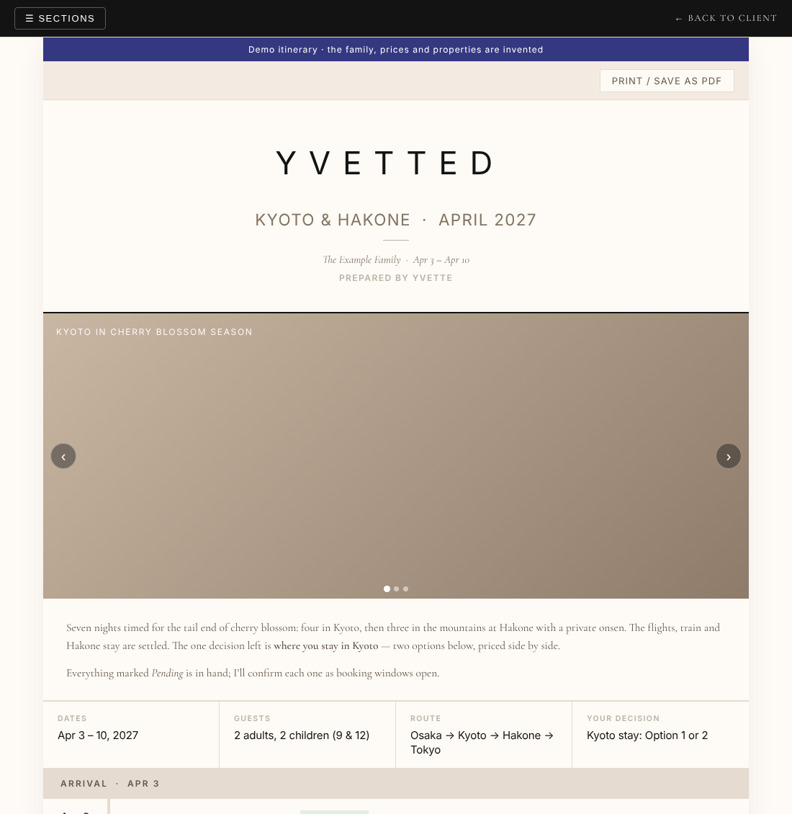
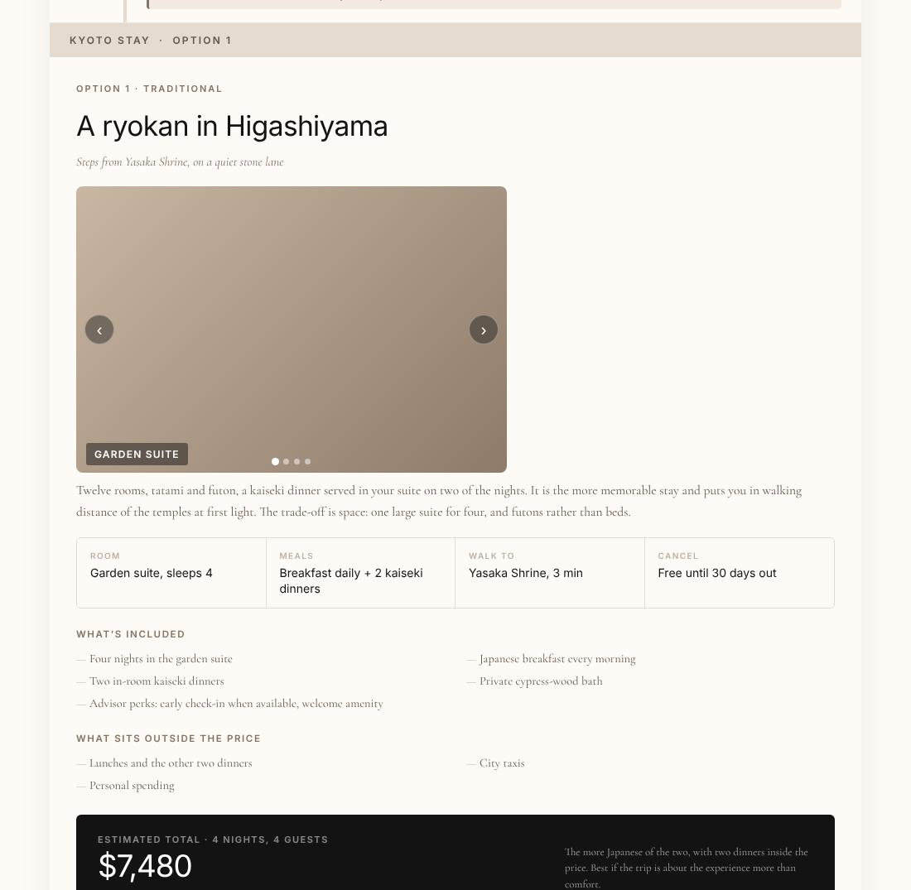

# Private client itinerary site (demo)

**[Open the demo trip →](https://travel-itinerary-demo-ten.vercel.app/trips/demo-kyoto-2027)** · [Site home](https://travel-itinerary-demo-ten.vercel.app)



**Context:** High-end travel clients expect a polished, private trip plan they can open on their phone, not a PDF lost in an email thread. They also need to compare options and decide quickly, without a long back-and-forth.

* **What I did (and why):** I built the website for my travel advisory, where each client gets a private, code-locked trip page. It shows the day-by-day plan with a clear status on every booking, photos, and priced options side by side, so the client makes one decision instead of reading ten emails. City guides are free to preview and fully unlock with the client's code.
* **Result:** Clients liked it, and it cut the back-and-forth over trip plans.

> This repo is a public demo. The trip, family, properties and prices are invented, and real client trips are removed. The restaurant guide is trimmed to a 12-table sample of the live one.



## Try it

```bash
npm install
npm run dev
```

Open http://localhost:3000/trips/demo-kyoto-2027.

- **Real client trips are code-locked:** without the right code, a trip URL redirects to the code page. The demo trip is left open (`OPEN_TRIPS` in `src/middleware.js`) so anyone can view it.
- To see the lock work, remove it from `OPEN_TRIPS`, then enter **`KYOTO-2027`** on `/client`. A valid code also unlocks the full Tokyo restaurant guide.

## How it works

| Part | File |
|---|---|
| Access codes, checked on the server only (never sent to the browser) | `src/app/api/auth/route.js` |
| Guard on every `/trips/*` page: the cookie must match that exact trip | `src/middleware.js` |
| Each trip is one self-contained HTML page, served with `no-store` caching | `src/app/trips/<slug>/` |
| City guides, with a free preview and a client unlock | `src/app/guides/`, `src/data/guides/` |
| Built with | Next.js, React, Tailwind, deployed on Vercel |

**Design choices**
- **One code per trip.** A code opens only its own trip, so sharing a link never exposes another client.
- **Status on everything.** Each booking shows Confirmed, Pending or TBD, so the client knows what's settled at a glance.
- **Options priced side by side** with what's included and excluded, so the decision is easy.
- **Print-ready.** Every trip page prints cleanly to PDF for clients who want paper.

To add a trip: put its page in `src/app/trips/<slug>/`, copy the `route.js`, and add a code in `src/app/api/auth/route.js`.
